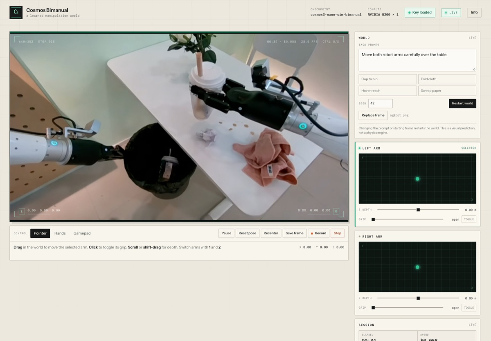

# Cosmos Bimanual

A bring-your-own-key web client for **NVIDIA Cosmos3 Nano Sim Bimanual** running on a B200 through [Reactor](https://reactor.inc). Move two robot arms, change the prompt, swap the starting frame, and watch a learned world model respond frame by frame.

**Live demo:** https://jay-aditya-16.github.io/cosmos-bimanual/

[](https://jay-aditya-16.github.io/cosmos-bimanual/)

## What it does

- Streams a live Cosmos3 Bimanual world over WebRTC.
- Controls both arms with pointer drag, Shift-drag for depth, webcam hand tracking, or a gamepad.
- Sends prompts, seeds, grips, and arm poses to the model.
- Accepts a custom starting image up to 4096 px per side.
- Saves generated frames and records the stream to WebM.
- Shows session time, spend, model steps, frame count, and stream health.
- Automatically closes the paid GPU session at 4:52, inside the model's five-minute limit.

Everything runs in the browser. There is no application server: GitHub Pages only serves the static build, and the browser talks to Reactor directly.

## Run it

1. Open the [live demo](https://jay-aditya-16.github.io/cosmos-bimanual/).
2. Click **Start world**.
3. Paste a Reactor API key with access to `reactor/cosmos3-nano-sim-bimanual`.
4. The page exchanges the key directly with `api.reactor.inc` for a short-lived token, then connects to the B200 session.

The model costs **$0.102 per minute** of GPU time, billed by Reactor to the account that owns the key. The session is capped at five minutes; this client stops it a few seconds early.

## Key safety

This is a static, bring-your-own-key app, so the key is handled in the browser.

- The key is kept in this tab's JavaScript memory only. It is not put in cookies, `localStorage`, or `sessionStorage`, and the page never sends it to its own host.
- The key is sent directly to `https://api.reactor.inc/tokens` to mint a token scoped to one session, 300 seconds, and a 15-minute expiry. The token is then used for the WebRTC session and uploads.
- Anyone with the key can spend your Reactor credits. Use a key you can rotate, and do not paste a key on a shared computer.
- Any JavaScript running in the page can read the key while it is loaded. That includes the app's own code and optional third-party code. The hand-tracking mode dynamically loads MediaPipe from jsDelivr; the interface also loads fonts from Google Fonts. Use your own judgment before enabling camera mode.
- No key is stored in this repository, and no key is sent to GitHub.

## Local development

Requires Node.js 22 or newer.

```bash
npm ci
npm run dev
```

Build the static site:

```bash
npm run build
npm run preview
```

The build output is written to `dist/`. Vite uses a relative base so the site works from a project Pages path.

## Deployment

The workflow in `.github/workflows/pages.yml` builds the site and publishes `dist/` to GitHub Pages on every push to `main`. Enable **Settings → Pages → Build and deployment → GitHub Actions** once in the repository settings.

## Stack

- [Vite](https://vite.dev) with vanilla JavaScript.
- [`@reactor-team/js-sdk`](https://www.npmjs.com/package/@reactor-team/js-sdk) 3.3.0 for token auth, WebRTC, commands, and uploads.
- [MediaPipe Tasks Vision](https://ai.google.dev/edge/mediapipe/solutions/vision/hand_landmarker) loaded on demand for hand tracking.
- Instrument Sans and IBM Plex Mono from Google Fonts.

The model is a learned predictive simulation, not a physics engine. It is not affiliated with NVIDIA or Reactor.

## License

MIT
